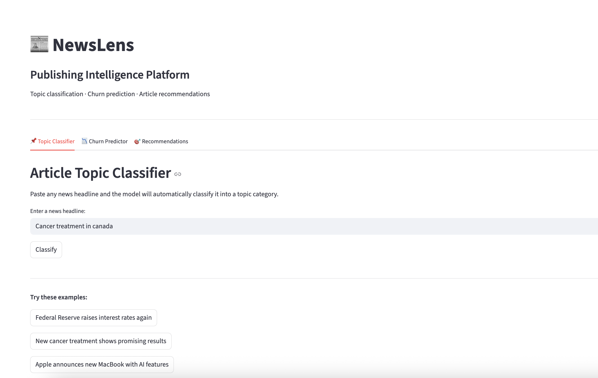

# NewsLens


NewsLens is a small end-to-end machine learning project that looks at a digital publisher's problems from three angles: what a piece of content is about, which readers are about to leave, and what to show those readers to bring them back.

I built it to practise putting several ML components into one pipeline, with experiment tracking, tests and CI around it, rather than leaving everything in a notebook.



## What it does

**1. Topic classification.** A TF-IDF and Logistic Regression model reads a news headline and predicts its category (Business, Science & Tech, Entertainment or Health). It reaches about 91% accuracy on a held-out set of 10,000 headlines.

**2. Churn prediction.** A Gradient Boosting model takes a reader's engagement numbers (articles per week, session length, days since last visit, newsletter opens and so on) and returns the probability that they will stop coming back.

**3. Recommendations.** A content-based recommender uses TF-IDF vectors and cosine similarity to pick representative articles from each topic. For readers flagged as at risk, the pipeline suggests articles to win them back.

The Streamlit dashboard puts all three in one place, one tab each.

## The data

- **News articles:** the [UCI News Aggregator dataset](https://archive.ics.uci.edu/dataset/359/news+aggregator), about 420,000 real headlines with category labels. I use a balanced sample of 50,000 for the classifier and 5,000 for the recommender.
- **Reader behaviour:** simulated. I don't have access to real subscriber data, so I generated 5,000 reader profiles with realistic engagement features, where lower engagement raises the chance of churn.

The churn score of about 0.98 ROC AUC mostly shows that the model can recover the pattern I put into the simulation. It says little about how it would perform on real readers, where behaviour is much noisier. I've kept the simulation in the project to show the full workflow, and swapping in real data would only mean changing `src/data.py`.

## Project structure

```
newslens-publishing-intelligence/
├── notebooks/
│   ├── 01_eda.ipynb              explore the dataset
│   ├── 02_nlp_topics.ipynb       headline classification
│   ├── 03_churn.ipynb            churn prediction
│   ├── 04_recommendations.ipynb  article recommender
│   └── 05_full_pipeline.ipynb    everything together
├── src/
│   ├── data.py                   loading, sampling, reader simulation
│   ├── nlp.py                    topic classifier
│   ├── churn.py                  churn model
│   ├── recommender.py            recommendation engine
│   └── utils.py                  shared text cleaning and constants
├── tests/                        pytest suite (22 tests)
├── .github/workflows/ci.yml      GitHub Actions
├── app.py                        Streamlit dashboard
├── main.py                       runs the full pipeline
├── Makefile
└── requirements.txt
```

I built everything in notebooks first to understand each step, then moved the logic into the `src/` modules so it can be tested and reused.

## How to run it

**1. Clone and set up the environment**

```bash
git clone https://github.com/haritha-1234/newslens-publishing-intelligence.git
cd newslens-publishing-intelligence
python -m venv venv
source venv/bin/activate
pip install -r requirements.txt
```

**2. Get the dataset**

```bash
mkdir -p data/processed
curl -L -o data/processed/news.zip \
  "https://archive.ics.uci.edu/ml/machine-learning-databases/00359/NewsAggregatorDataset.zip"
cd data/processed && unzip news.zip && cd ../..
```

**3. Create the cleaned file**

Run `notebooks/01_eda.ipynb` from top to bottom. It reads `newsCorpora.csv` and saves `data/processed/news_clean.csv`, which the rest of the project uses.

**4. Train everything**

```bash
python main.py
```

This trains the three components, logs the runs to MLflow, saves the models to `data/processed/`, and prints a sample re-engagement run for a few readers.

**5. Open the dashboard**

```bash
streamlit run app.py
```

**6. Look at the experiments (optional)**

```bash
mlflow ui
```

Then open http://127.0.0.1:5000.

A Makefile is included for the common commands: `make run`, `make app`, `make test` and `make clean`.

## Experiment tracking

Every training run logs its parameters, metrics and model to MLflow, so different versions can be compared and any result reproduced. The topic classifier and churn model each have their own tracked runs.

## Tests and CI

The pytest suite has 22 tests across data handling, the topic classifier, the churn model and the recommender. The tests build small fake datasets, so they run in seconds and don't need the full news corpus.

```bash
python -m pytest tests/ -v
```

GitHub Actions runs the same tests on every push and pull request.

## Limitations and what I would do next

- The reader data is simulated, so the churn results are a demonstration of the method and not a real-world benchmark.
- The recommender is content-based and uses headlines only. It doesn't use individual reading history, and the article text itself isn't used.
- The recommender works on a 5,000-article sample. At full scale I would switch to approximate nearest neighbour search instead of a full similarity matrix.
- Next steps I would like to try: sentence embeddings instead of TF-IDF, collaborative filtering once there is real interaction data, and evaluating recommendations with a proper offline metric.

## Tech stack

Python, pandas, NumPy, scikit-learn, MLflow, Streamlit, pytest, GitHub Actions

## Author

**Haritha Retnakaran**, Data Scientist Trainer based in Hamburg.
[GitHub](https://github.com/haritha-1234) · [LinkedIn](https://linkedin.com/in/haritha-retnakaran-341448162/)